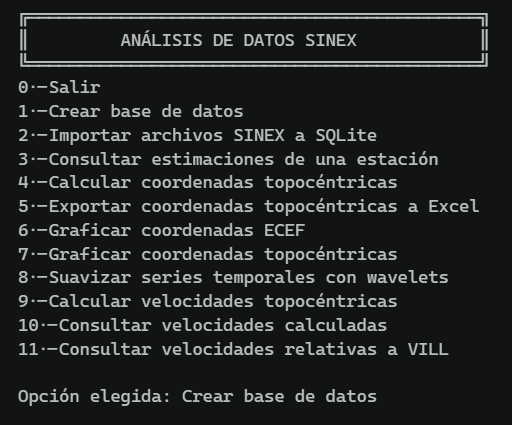
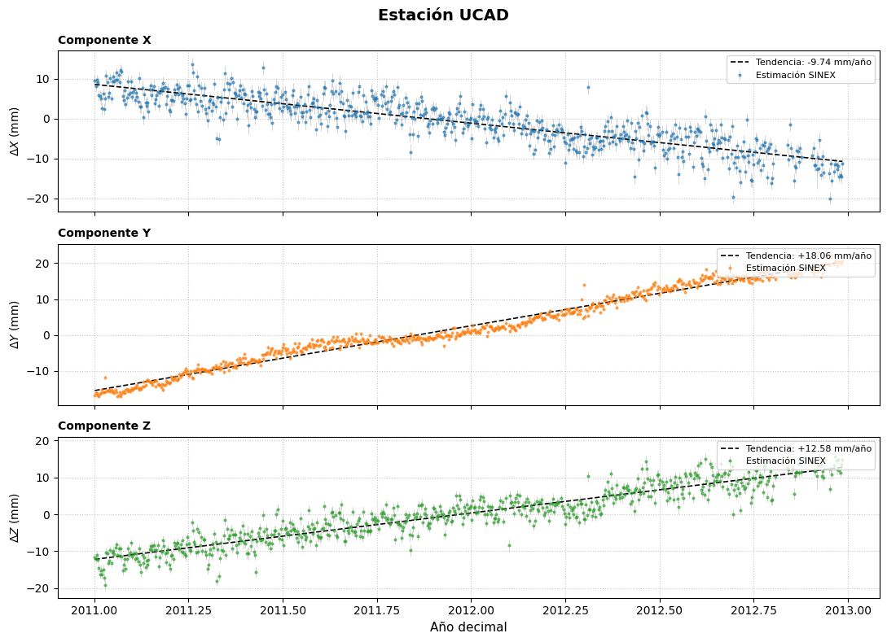
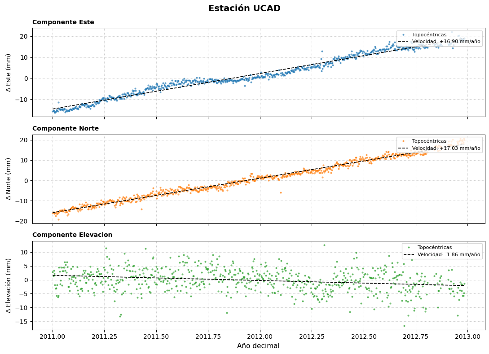
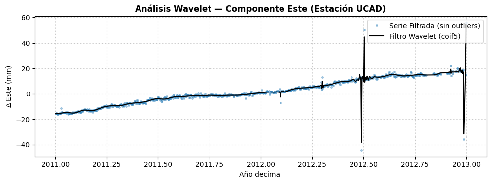

# Geodetic-Data-Processing
# SINEX Geodetic Analysis

**Procesamiento y análisis de datos geodésicos GNSS mediante Python, SQLite y herramientas de análisis numérico.**

## Descripción

Este proyecto consiste en el desarrollo de una aplicación en Python para el procesamiento, almacenamiento y análisis de datos geodésicos procedentes de archivos SINEX.

El programa permite gestionar las estimaciones de distintas estaciones GNSS mediante una base de datos SQLite, calcular coordenadas topocéntricas, representar gráficamente las series temporales, aplicar técnicas de suavizado mediante wavelets y calcular velocidades de desplazamiento.

La aplicación dispone de un menú interactivo desde el que se puede acceder a las distintas funcionalidades.

## Funcionalidades

El programa incluye las siguientes opciones:

| Opción | Funcionalidad |
|---|---|
| 0 | Salir del programa |
| 1 | Crear la base de datos |
| 2 | Importar archivos SINEX a SQLite |
| 3 | Consultar estimaciones de una estación |
| 4 | Calcular coordenadas topocéntricas |
| 5 | Exportar coordenadas topocéntricas a Excel |
| 6 | Graficar coordenadas ECEF |
| 7 | Graficar coordenadas topocéntricas |
| 8 | Suavizar series temporales mediante wavelets |
| 9 | Calcular velocidades topocéntricas |
| 10 | Consultar velocidades calculadas |
| 11 | Consultar velocidades relativas a VILL |

## Tecnologías utilizadas

- **Python:** desarrollo de la aplicación y procesamiento de datos.
- **SQLite:** almacenamiento y consulta de las estimaciones y resultados.
- **NumPy:** operaciones numéricas y cálculos científicos.
- **Pandas:** gestión y organización de datos tabulares.
- **Matplotlib:** representación gráfica de coordenadas y series temporales.
- **PyWavelets (`pywt`):** suavizado de series temporales mediante wavelets.
- **Excel:** exportación de los resultados de coordenadas topocéntricas.

## Requisitos

Para ejecutar el programa se necesita Python 3 y las bibliotecas utilizadas por el proyecto.

Instala las dependencias con:

```bash
pip install numpy pandas matplotlib PyWavelets openpyxl
```

El módulo `sqlite3` forma parte de la biblioteca estándar de Python, por lo que normalmente no es necesario instalarlo por separado.

## Instalación y ejecución

1. Clona el repositorio:

   ```bash
   git clone https://github.com/TU-USUARIO/SINEX-Geodetic-Analysis.git
   ```

2. Accede al directorio del proyecto:

   ```bash
   cd SINEX-Geodetic-Analysis
   ```

3. Ejecuta el programa:

   ```bash
   python main.py
   ```

   Sustituye `main.py` por el nombre real del archivo principal si es diferente.

## Resultados

## Resultados

### Menú principal

La aplicación cuenta con un menú interactivo que permite acceder a las distintas funcionalidades de procesamiento y análisis de datos SINEX.



### Coordenadas ECEF

Representación de las componentes cartesianas geocéntricas X, Y y Z de una estación GNSS a lo largo del tiempo.



### Coordenadas topocéntricas

Visualización de las componentes Este, Norte y Elevación para estudiar los desplazamientos de las estaciones.



### Suavizado de series temporales mediante wavelets

Aplicación de técnicas de suavizado mediante wavelets para analizar las series temporales de las coordenadas topocéntricas.



### 1. Coordenadas ECEF

Representación gráfica de las coordenadas cartesianas geocéntricas (X, Y, Z) de una estación GNSS a lo largo del tiempo.


### 2. Coordenadas topocéntricas

Representación de las componentes topocéntricas Este, Norte y Altura (ENU), que permite analizar los desplazamientos de una estación respecto a su posición de referencia.


### 3. Suavizado de series temporales mediante wavelets

Ejemplo del suavizado de las series temporales para estudiar su evolución y reducir las componentes de ruido.


### 4. Velocidades topocéntricas

Resultados del cálculo de las velocidades de desplazamiento en las componentes Este, Norte y Altura.


### 5. Velocidades relativas a VILL

Resultados del cálculo de velocidades de las estaciones respecto a la estación de referencia VILL.


> **Nota:** las imágenes anteriores son rutas de ejemplo. Sustituye los archivos por tus capturas reales y utiliza los nombres correspondientes a las imágenes que incluyas en el repositorio.

## Estructura del proyecto

Una posible organización del repositorio es la siguiente:

```text
SINEX-Geodetic-Analysis/
│
├── main.py
├── README.md
├── requirements.txt
│
├── datos/
│   └── meteo.db
│
├── SINEX/
│   └── archivos_sinex.SNX
│
└── imagenes/
    ├── coordenadas_ecef.png
    ├── coordenadas_topocentricas.png
    ├── suavizado_wavelets.png
    ├── velocidades_topocentricas.png
    └── velocidades_relativas_vill.png
```

La estructura es orientativa y debe adaptarse a la organización real del proyecto.

## Objetivos

- Automatizar la importación y gestión de datos geodésicos procedentes de archivos SINEX.
- Facilitar la consulta de estimaciones de estaciones GNSS.
- Transformar y analizar coordenadas geocéntricas y topocéntricas.
- Visualizar la evolución temporal de las componentes de posición.
- Aplicar técnicas de procesamiento de señales mediante wavelets.
- Calcular y consultar velocidades topocéntricas y relativas.

## Autoría

Proyecto desarrollado como aplicación de programación científica para el procesamiento y análisis de datos geodésicos mediante Python.
